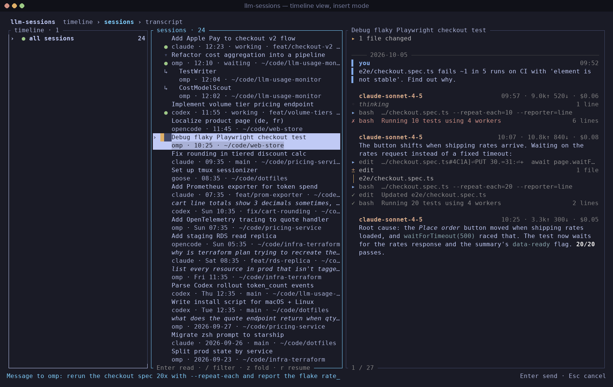
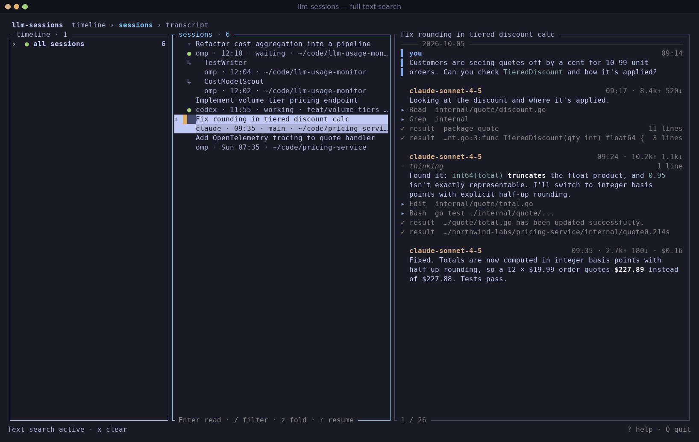
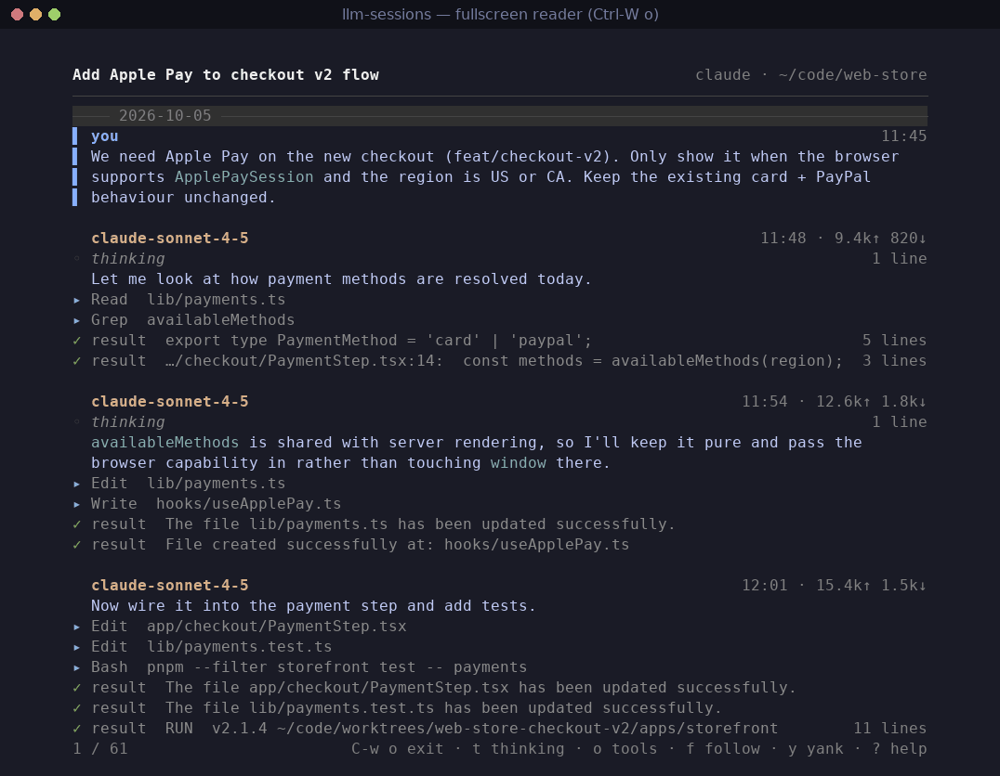
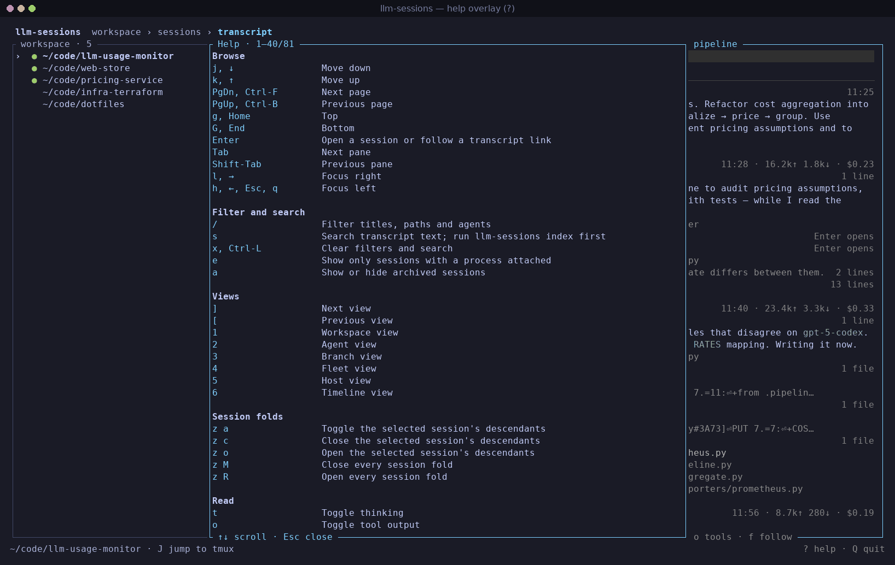

# llm-sessions

> Workspace-first explorer for local LLM coding-agent sessions.

Reads every coding agent's history and answers one question: **what happened in _this project_?**

```
$ llm-sessions workspaces
 102  ~/code/web-store         claude omp opencode
  43  ~/code/pricing-service   codex omp opencode
 101  ~/code/llm-usage-monitor codex opencode
```

Run with no arguments to browse workspaces → sessions → transcripts, all
agents merged into one list.

## Screenshots


<details>
<summary>More screenshots</summary>

| Timeline view `6`, insert mode `i` | Full-text search `s` |
|---|---|
|  |  |
| **Fullscreen reader `Ctrl-W o`** | **Help `?`** |
|  |  |

</details>


## Install

```sh
cargo install llm-sessions   # or `cargo install --path .` from a checkout
```

Requires Rust 1.96+ (pinned in `rust-toolchain.toml`). Linux only: liveness
reads `/proc`.

## TUI basics

- Arrows or `j` `k` move, `Enter` opens, `Esc` goes back, `Tab` switches panes.
- `/` filters, `s` full-text search (needs `llm-sessions index`), `x` clears.
- `i` insert mode: send one message to the selected session's agent via its
  headless CLI.
- `?` lists every key.

## Sources

| Agent | Store | Archive |
|---|---|---|
| OMP | `~/.omp/agent/sessions/<bucket>/*.jsonl` | overlay |
| Claude Code | `~/.claude/projects/<dir>/*.jsonl` | overlay |
| Codex | `~/.codex/sessions/**/rollout-*.jsonl` + `state_5.sqlite` | native |
| OpenCode (v1, v2) | `~/.local/share/opencode/opencode.db` | native |
| Copilot CLI | `~/.copilot/session-store.db` + `session-state/` | overlay |
| Kilo | `~/.local/share/kilo/kilo.db` | native |
| Goose | `~/.local/share/goose/sessions/*.jsonl` + `projects.json` | overlay |
| Cursor CLI | `~/.cursor/projects/*/agent-transcripts/**/*.jsonl` | overlay |
| Gemini CLI | `~/.gemini/tmp/<hash>/chats/*.json` | overlay |
| Hermes | `~/.hermes/state.db` | native |
| OpenClaw | `~/.openclaw/agents/*/sessions/*.jsonl` + `sessions.json` | overlay |

Missing agents are skipped; a failing source degrades to a status-bar
warning. Not supported: Cursor GUI stores, Antigravity, Devin.

## Remote hosts

Configure in `$XDG_CONFIG_HOME/llm-sessions/hosts.json`:

```json
{ "hosts": [
  { "name": "nx-1", "ssh": "nx-1.example.net", "home": "/var/lib/hermes", "sources": ["hermes"] }
] }
```

Remote sessions appear beside local ones (`--host` filter, `host:` in
queries, host view `5`). With `llm-sessions` installed on the host its JSON
output is used; otherwise a generated `sh` script lists stores over one SSH
connection (`mode`: `"auto"`, `"llm-sessions"`, or `"shell"`). Connections
use `BatchMode=yes`, so passphrase-protected hosts fail fast.

```sh
llm-sessions hosts                                            # list + probe
llm-sessions hosts add nx-1 nx-1.example.net --source hermes  # repeatable --source
llm-sessions hosts remove nx-1
```

## Commands

```sh
llm-sessions                     # interactive explorer
llm-sessions list                # newest 50 sessions (--json, -q '<query>', --format, -0)
llm-sessions workspaces          # project totals, live first
llm-sessions show <id>           # transcript; --thinking --tools, --format md -o out.md
llm-sessions index               # build/update the optional text index
llm-sessions search <words>      # full-text search
llm-sessions digest --since 24h  # recent activity by project
llm-sessions top                 # one row per running agent
llm-sessions usage --by workspace --since 7d   # also: model, agent, day
llm-sessions archive <id>        # --undo restores
llm-sessions sources             # detected stores and scan costs
llm-sessions doctor              # diagnostics; never applies fixes (--json)
llm-sessions completions bash
llm-sessions man
```

`--read-only` refuses archiving, indexing, tmux focus changes, and saving
bookmarks.

## Keys

| Key | Action |
|---|---|
| `j` `k` `↓` `↑`, `PgDn` `PgUp`, `g` `G` | move, page, top/bottom |
| `Enter` | open next pane; on a transcript link, read the subagent |
| `→` `l` / `←` `h` `Esc` | focus pane right / left |
| `]` `[` / `1`…`6` | cycle / jump to views: workspace, agent, branch, fleet, host, timeline |
| `/` `s` `x` `Ctrl-R` | filter / search / clear / rescan |
| `f` | follow: tail the session live |
| `J` | jump tmux focus to the selected live session |
| `z a` `z c` `z o` / `z M` `z R` | fold one session's descendants / all folds |
| `a` `e` | toggle archived / only live sessions |
| `Space` `v` `V` / `d` `u` | select one / all visible / group; archive / restore (asks first) |
| `t` `o` `c` | unfold thinking / tool output / changed files |
| `y y` / `y A` / `y r` / `y i` / `y p` | yank the assistant reply under the reader's cursor (the latest one from the lists) / the whole transcript (as folded on screen) / the resume command / the session id / its transcript file or database path to the clipboard |
| `Ctrl-W o` `F11` | fullscreen reader (`Ctrl-W ←` `→` resize, `=` reset) |
| `r` | quit, printing the resume command |
| `i` | insert: send one message to the selected session |
| `m` `'` `` ` `` | set / jump to bookmarks |
| `?` `F1` | help |
| `q` / `Q` `Ctrl-C` | back / quit |

`r` prints a shell-quoted resume command — paste it into your shell; don't
run it via `$(llm-sessions)`, which won't interpret the quoting.

Clipboard copying requires an installed helper: `wl-copy` (Wayland),
`xclip` or `xsel` (X11), `pbcopy` (macOS), or `clip.exe` (WSL).
Wayland/X11 helpers also require access to the display (`WAYLAND_DISPLAY` /
`DISPLAY`); headless or SSH sessions may have no usable clipboard.
Copying runs in the background; progress and failures appear in the status bar.

`i` runs the agent's one-shot command in the session's directory off the UI
thread (killed after 30 min; the message is one argv element, never shell
text). Each conversation keeps one writer:

- **OMP, Hermes** resume only an idle session
  (`omp --print --resume <id> -- <msg>`,
  `hermes chat --quiet --resume <id> --query=<msg>`); a session with any
  process attached is refused — use `J` to jump to its pane.
- **OpenCode** with a live client sends to the one loopback server that
  client is connected to (read from its sockets in `/proc`); no server or
  several is refused. An idle session gets plain `opencode run --session <id>`.

Subagents, remote rows, and `--read-only` are refused too.

## Liveness

| | Meaning |
|---|---|
| `●` | **exact** — a process holds the session file open (`/proc/<pid>/fd`) |
| `○` | **inferred** — right agent, cwd rolls up to the workspace |
| `·` | written recently, nothing attached |
| ` ` | stale |

Live rows also show the tmux pane and working/waiting state. `J` moves tmux
focus there; `Enter` opens the transcript. A process holding a subagent
transcript open marks its parent live too.

## Query language

One grammar across `/`, `s`, and `list -q`:

```
source:omp  agent:codex  ws:dstm  branch:feat/x  model:glm
id:01a0  after:7d  before:today  cost:>1
live:yes  archived:only  body:naming  bare words = free text
```

`body:` needs the index; `archived:` overrides the `a` toggle. Unknown keys
are treated as free text — a typo narrows results, never fails.

## Design notes

- **No index for browsing.** A full cross-agent scan takes ~80 ms, so the
  TUI rescans every 2 s. The FTS5 index exists only for body search and
  spend caching.
- **Workspaces roll up.** cwds canonicalize to their repository; linked
  worktrees map to the main one. Ranking is liveness first, then recency
  with a 7-day half-life.
- **Derived names are honest.** Missing or duplicated titles get a label
  from the first user prompt, rendered in italic.
- **Subagents and forks are trees.** Children nest under their parent;
  `Enter` on a delegating tool call follows into the child's transcript.
- **Times are shown on your clock.** Stores record UTC (`--json` emits it);
  displayed timestamps use the machine's offset.
- **Paths are never decoded.** They come from recorded fields; where none
  exists, the decoded guess is marked `~`.
- **Unknown records survive.** Unrecognized record types become folded
  raw-JSON blocks; a session never fails to open.
- **Agent stores are read-only.** The only writes are archiving (native
  where the agent models it, an overlay db otherwise) and `llm-sessions`'s
  own databases. Credential files are never opened.

### Source layout

- `src/catalog/` — scan, query grammar, labels, workspace identity.
- `src/source/` — agent adapters, schema decoding, `remote/` SSH transport.
- `src/storage/` — index, archive overlay, bookmarks, SQLite access.
- `src/runtime/` — process facts, liveness, tmux, resume, diagnostics.
- `src/output/` — reader, exports, list rows, digests, usage reports.
- `src/tui/` — `app/` state and effects, `view.rs`, `ui.rs`, `keymap.rs`.
- `src/cli/` — argument definitions, one file per command group.

Development: toolchain pinned (1.96.0); CI runs fmt, pedantic clippy,
rustdoc with `-D warnings`, tests, and a non-blocking `cargo audit`.

## Storage `llm-sessions` owns

| Path | What |
|---|---|
| `$XDG_STATE_HOME/llm-sessions/overlay.db` | archive state for agents without it |
| `$XDG_CACHE_HOME/llm-sessions/index.db` | FTS5 body index, spend cache; delete any time |

Both are disposable. The index is large (~690 MB per ~5 GB of bodies) and
only written by `llm-sessions index`; `--since`/`--max-bytes` bound it,
`--max-body` truncates oversized tool output, `--vacuum` reclaims pages.

## License

MIT
